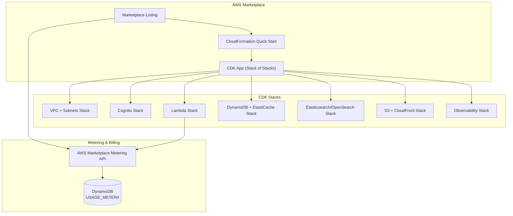
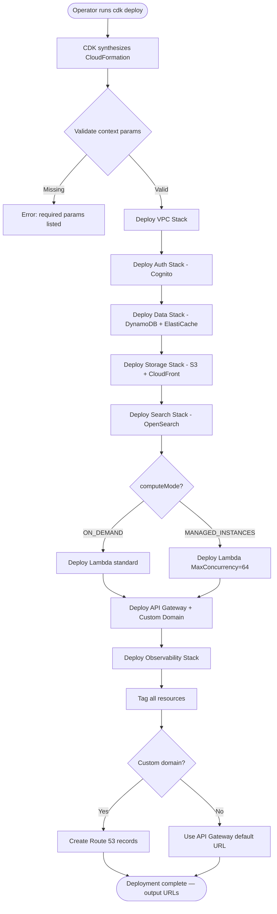
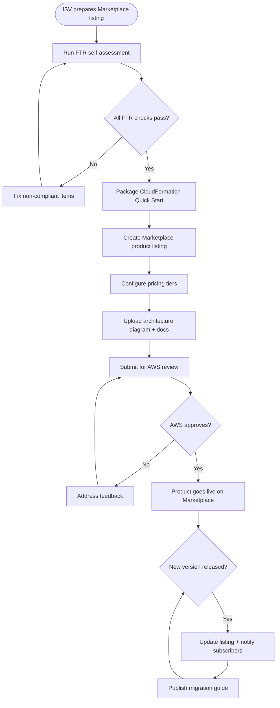
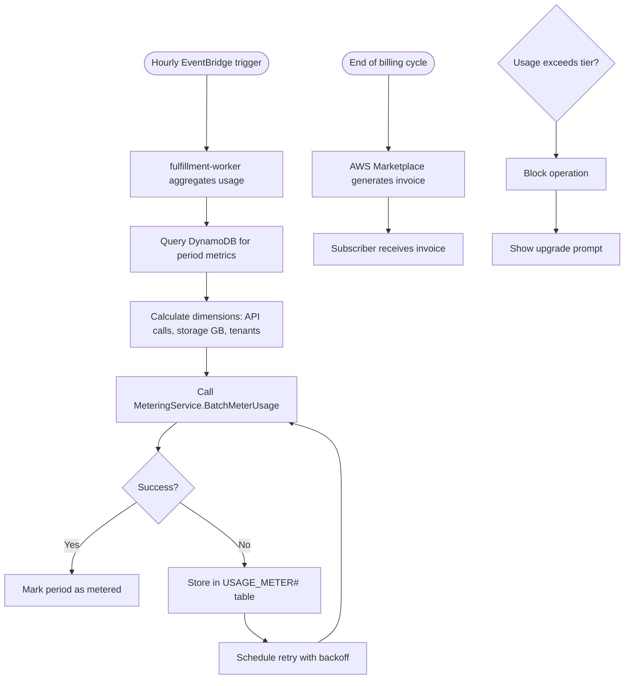

# Module 13: Deployment Infrastructure & AWS Marketplace

> **Slice**: v5.0 · **Sprint**: 5.1 · **Stories**: US-13.1.1 – US-13.1.3

## Overview

Covers CDK infrastructure-as-code packaging, AWS Marketplace listing with FTR (Foundational Technical Review) compliance, SaaS metering & contract billing, and deployment automation.

---

## Infrastructure Architecture



---

## US-13.1.1: CDK Infrastructure Stack Packaging

**As a** DevOps Engineer or ISV Partner,  
**I want** a single CDK application that deploys the entire some-commerce platform as a CloudFormation stack of stacks,  
**So that** I can provision a complete environment in any AWS region with one command.

### Acceptance Criteria

```gherkin
Feature: CDK Infrastructure Stack

  Scenario: Deploy full platform with default config
    Given the operator runs "cdk deploy --context computeMode=ON_DEMAND"
    Then all nested stacks deploy in the correct order:
      1. VPC + Subnets (public, private, isolated)
      2. Cognito User Pool + Identity Pool
      3. DynamoDB Tables + GSIs + ElastiCache Serverless
      4. S3 Buckets (SDUI assets, digital vault, AWB labels) + CloudFront
      5. Lambda functions (5 binaries compiled for AL2023 + arm64/Graviton)
      6. API Gateway HTTP API + custom domain
      7. Elasticsearch/OpenSearch domain
      8. Observability (CloudWatch, X-Ray, alarms)
    And all resources are tagged with: Project=some-commerce, Environment=prod

  Scenario: Deploy with Managed Instances
    Given the context is computeMode=MANAGED_INSTANCES
    Then Lambda MaxConcurrency=64 is set for all functions
    And DynamoDB Zero-ETL pipeline to OpenSearch is configured

  Scenario: Multi-region deployment
    When deploying to me-south-1 (Bahrain) and eu-central-1 (Frankfurt)
    Then DynamoDB global tables replicate between regions
    And CloudFront distributions point to the nearest origin

  Scenario: Destroy all resources
    When the operator runs "cdk destroy"
    Then all resources are cleanly removed
    And S3 buckets with data require explicit --force flag

  Scenario: CDK stack with custom domain
    Given the operator provides domainName=store.example.com and acmCertArn=arn:...
    Then API Gateway maps to the custom domain
    And CloudFront uses the ACM certificate
    And Route 53 records are created if hostedZoneId is provided
```

### Test Cases

| # | Test Case | Type | Expected Result |
|:--|:----------|:-----|:----------------|
| TC-13.1.1-01 | Full ON_DEMAND deployment | Happy Path | All stacks created |
| TC-13.1.1-02 | MANAGED_INSTANCES deployment | Happy Path | MaxConcurrency set |
| TC-13.1.1-03 | Multi-region with global tables | Happy Path | Replication active |
| TC-13.1.1-04 | Destroy all resources | Happy Path | Clean teardown |
| TC-13.1.1-05 | Custom domain + ACM | Happy Path | Domain mapped |
| TC-13.1.1-06 | Missing required context | Validation | Clear error message |
| TC-13.1.1-07 | IAM least-privilege policies | Security | No wildcards in prod |
| TC-13.1.1-08 | Stack drift detection | DevOps | Drift reported |
| TC-13.1.1-09 | cdk diff before deploy | DevOps | Change set preview |
| TC-13.1.1-10 | Cross-stack references | Integration | Exports/imports correct |

### Activity Diagram



---

## US-13.1.2: AWS Marketplace Listing & FTR Compliance

**As an** ISV listing some-commerce on the AWS Marketplace,  
**I want** the product to pass the Foundational Technical Review (FTR) and be listed as a SaaS or AMI product,  
**So that** AWS customers can discover, subscribe, and deploy the platform through the Marketplace.

### Acceptance Criteria

```gherkin
Feature: AWS Marketplace Listing

  Scenario: FTR audit compliance
    Given the product is submitted for FTR
    Then the following requirements are met:
      - No hardcoded AWS credentials in code or config
      - All data encrypted at rest (KMS) and in transit (TLS 1.2+)
      - CloudTrail logging enabled for all API calls
      - IAM policies follow least-privilege principle
      - VPC configuration uses private subnets for compute
      - Customer data isolation (DynamoDB tenant_id partitioning)
      - GDPR data deletion capabilities via Right to Erasure API
      - SOC 2 Type II compatible logging and audit trails

  Scenario: Quick Start CloudFormation template
    Given the Marketplace listing includes a Quick Start template
    When a customer clicks "Continue to Subscribe" → "Continue to Configuration"
    Then the CloudFormation stack launch page opens with:
      - Required params: AdminEmail, TenantName
      - Optional params: computeMode, domainName, acmCertArn
      - Default VPC CIDR and subnet allocation
    And the stack deploys within 25 minutes

  Scenario: Marketplace product page
    Then the listing page includes:
      - Product description with feature highlights
      - Architecture diagram
      - Pricing tiers (Free Tier, Standard, Enterprise)
      - Support information and documentation links
      - Usage guide and getting started tutorial

  Scenario: Software version update
    When a new version is released
    Then the Marketplace listing is updated
    And existing subscribers receive an update notification
    And a migration guide is published
```

### Test Cases

| # | Test Case | Type | Expected Result |
|:--|:----------|:-----|:----------------|
| TC-13.1.2-01 | FTR: no hardcoded credentials | Security | Pass |
| TC-13.1.2-02 | FTR: data encrypted at rest | Security | KMS on all storage |
| TC-13.1.2-03 | FTR: TLS 1.2+ in transit | Security | All endpoints HTTPS |
| TC-13.1.2-04 | FTR: CloudTrail enabled | Audit | All API calls logged |
| TC-13.1.2-05 | FTR: least-privilege IAM | Security | No * permissions |
| TC-13.1.2-06 | FTR: private subnets | Network | Lambda in private subnet |
| TC-13.1.2-07 | FTR: tenant isolation | Security | DynamoDB partitioned |
| TC-13.1.2-08 | FTR: GDPR deletion | Compliance | Right to Erasure works |
| TC-13.1.2-09 | Quick Start deployment | Happy Path | Deploys in <25 min |
| TC-13.1.2-10 | Subscriber notification on update | Happy Path | Notification sent |
| TC-13.1.2-11 | Product page completeness | Validation | All sections present |
| TC-13.1.2-12 | Version rollback capability | DevOps | Previous version restorable |

### Activity Diagram



---

## US-13.1.3: SaaS Metering & Usage-Based Billing

**As a** SaaS-mode Marketplace subscriber,  
**I want** my usage (API calls, storage GB, active tenants) to be automatically metered and billed,  
**So that** I pay only for what I use.

### Acceptance Criteria

```gherkin
Feature: SaaS Metering & Billing

  Scenario: Hourly usage metering
    Given the platform runs for a subscriber
    Then every hour, the fulfillment-worker aggregates:
      - Total API requests
      - DynamoDB consumed WCU/RCU
      - S3 storage GB
      - Active tenant count
    And calls MeteringService.BatchMeterUsage with the dimensions

  Scenario: Monthly invoice generation
    Given the end of the billing cycle
    Then AWS Marketplace generates an invoice based on metered dimensions
    And the subscriber receives the invoice via AWS

  Scenario: Free tier enforcement
    Given the subscriber is on the Free Tier (1,000 products, 1 tenant)
    When the subscriber exceeds 1,000 products
    Then product creation is blocked with "Free tier limit reached"
    And an upgrade prompt is shown

  Scenario: Metering failure recovery
    Given a BatchMeterUsage call fails
    Then the usage records are persisted in DynamoDB USAGE_METER# table
    And retried with exponential backoff
    And no usage data is lost
```

### Test Cases

| # | Test Case | Type | Expected Result |
|:--|:----------|:-----|:----------------|
| TC-13.1.3-01 | Hourly metering call | Happy Path | Usage reported |
| TC-13.1.3-02 | Monthly invoice | Happy Path | Invoice generated |
| TC-13.1.3-03 | Free tier product limit | Validation | Creation blocked |
| TC-13.1.3-04 | Free tier tenant limit | Validation | Tenant creation blocked |
| TC-13.1.3-05 | Metering failure retry | Error | Data persisted, retried |
| TC-13.1.3-06 | Upgrade from free to standard | Happy Path | Limits updated |
| TC-13.1.3-07 | Metering data accuracy | Validation | Matches actual usage |
| TC-13.1.3-08 | Concurrent metering calls | Concurrency | No double counting |

### Activity Diagram



---

## Deployment Quick Reference

### Prerequisites

| Requirement | Version | Purpose |
|:------------|:--------|:--------|
| AWS CDK CLI | ≥ 2.150 | Infrastructure deployment |
| Rust toolchain | ≥ 1.80 (nightly) | Lambda binary compilation |
| Node.js | ≥ 20 LTS | CDK synth + Expo |
| Docker | ≥ 24 | Cross-compilation for arm64 |
| AWS Account | — | Target account with AdministratorAccess |

### Environment Variables

```bash
# Required
CDK_DEFAULT_ACCOUNT=123456789012
CDK_DEFAULT_REGION=me-south-1
COMPUTE_MODE=ON_DEMAND  # or MANAGED_INSTANCES

# Optional
DOMAIN_NAME=store.example.com
ACM_CERT_ARN=arn:aws:acm:us-east-1:123456789012:certificate/xxx
HOSTED_ZONE_ID=Z1234567890ABC
```

### Deployment Commands

```bash
# Install CDK dependencies
npm ci

# Compile Rust binaries for arm64 (Graviton)
cargo lambda build --release --arm64

# Synthesize and deploy
cdk synth
cdk deploy --all --context computeMode=ON_DEMAND

# Destroy (with caution)
cdk destroy --all --force
```

### Cost Estimation by Edition

| Component | Standard (ON_DEMAND) | Enterprise (MANAGED) |
|:----------|:--------------------|:--------------------|
| Lambda | $0 idle, pay-per-request | ~$180/mo (64 reserved) |
| DynamoDB | On-demand, ~$25/mo | On-demand, ~$25/mo |
| ElastiCache | Serverless, ~$50/mo | Serverless, ~$50/mo |
| OpenSearch | t3.small.search, ~$30/mo | r6g.large, ~$200/mo |
| S3 + CloudFront | ~$10/mo | ~$10/mo |
| Cognito | Free tier (50k MAU) | Free tier |
| **Total idle** | **~$115/mo** | **~$465/mo** |
