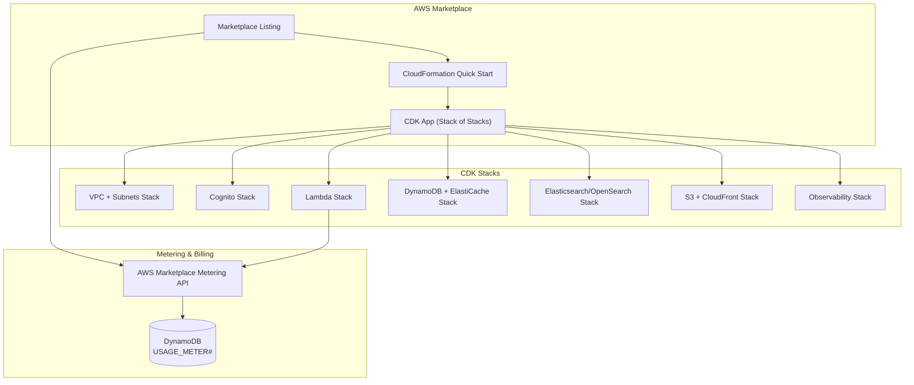

# Module 13: Deployment Infrastructure & AWS Marketplace

> **Slice**: v5.0 · **Sprint**: 5.1 · **Stories**: US-13.1.1 – US-13.1.3

## Overview

Covers CDK infrastructure-as-code packaging, AWS Marketplace listing with FTR (Foundational Technical Review) compliance, SaaS metering & contract billing, and deployment automation.

---

## Infrastructure Architecture



---

## User Stories Catalog

This module contains **3 detailed user stories**. Each user story has its own dedicated specification document containing Gherkin acceptance criteria (`Given/When/Then`), comprehensive test matrices (happy path, edge cases, error handling, security, and concurrency), Mermaid activity diagrams, and the 7-PR implementation slice plan.

| Story ID | Title | Target Persona | Sprint | Specification Document |
| :--- | :--- | :--- | :--- | :--- |
| **[US-13.1.1](us-13.1.1-cdk-infrastructure-stack-packaging.md)** | CDK Infrastructure Stack Packaging | DevOps Engineer or ISV Partner | Sprint 5.1 | [View Specification →](us-13.1.1-cdk-infrastructure-stack-packaging.md) |
| **[US-13.1.2](us-13.1.2-aws-marketplace-listing-ftr-compliance.md)** | AWS Marketplace Listing & FTR Compliance | ISV listing some-commerce on the AWS Marketplace | Sprint 5.1 | [View Specification →](us-13.1.2-aws-marketplace-listing-ftr-compliance.md) |
| **[US-13.1.3](us-13.1.3-saas-metering-usage-based-billing.md)** | SaaS Metering & Usage-Based Billing | SaaS-mode Marketplace subscriber | Sprint 5.1 | [View Specification →](us-13.1.3-saas-metering-usage-based-billing.md) |

---

## Story Summaries

#### [US-13.1.1: CDK Infrastructure Stack Packaging](us-13.1.1-cdk-infrastructure-stack-packaging.md)
- **Target Persona**: DevOps Engineer or ISV Partner
- **Summary**: CDK Infrastructure Stack Packaging
- **Specification**: [`us-13.1.1-cdk-infrastructure-stack-packaging.md`](us-13.1.1-cdk-infrastructure-stack-packaging.md)

#### [US-13.1.2: AWS Marketplace Listing & FTR Compliance](us-13.1.2-aws-marketplace-listing-ftr-compliance.md)
- **Target Persona**: ISV listing some-commerce on the AWS Marketplace
- **Summary**: AWS Marketplace Listing & FTR Compliance
- **Specification**: [`us-13.1.2-aws-marketplace-listing-ftr-compliance.md`](us-13.1.2-aws-marketplace-listing-ftr-compliance.md)

#### [US-13.1.3: SaaS Metering & Usage-Based Billing](us-13.1.3-saas-metering-usage-based-billing.md)
- **Target Persona**: SaaS-mode Marketplace subscriber
- **Summary**: SaaS Metering & Usage-Based Billing
- **Specification**: [`us-13.1.3-saas-metering-usage-based-billing.md`](us-13.1.3-saas-metering-usage-based-billing.md)


---

## Autonomous Agent Implementation Standard

Every user story in this module is executed by an autonomous AI agent across the standardized **7-PR vertical slice framework**:

```
[PR 1: Kernel Core] ──> [PR 2: DB Schema] ──> [PR 3: Repo & Cache] ──> [PR 4: Axum API]
                                                                            │
[PR 7: Platform UI] <── [PR 6: Headless Hooks] <── [PR 5: Client Service & DB] <┘
```

1. **PR 1: Microkernel Logic** (`crates/kernel-core`)
2. **PR 2: Database Schema** (`crates/db-schema`)
3. **PR 3: Repository Handlers & Caching** (`crates/db-dynamo`, `crates/cache-tier`)
4. **PR 4: Axum Handlers & Middleware** (`bins/...`)
5. **PR 5: Client Services & Local Database** (`packages/api-client`, `packages/db-client`)
6. **PR 6: Headless Domain Hooks & Native Modules** (`packages/domain-hooks`, `modules/...`)
7. **PR 7: Platform-Adaptive UI** (`apps/storefront-mobile` with `@expo/ui`, `apps/storefront-web` with Tailwind CSS v4)

---

## Navigation & Cross-References

- [← Back to Master User Stories Index](../README.md)
- [Sprint Schedule & 3-Agent Parallel Framework](../../sprints/README.md)
- [System Architecture & Multi-Tier Caching](../../SYSTEM_ARCHITECTURE.md)
- [Deployment & AWS Marketplace Guide](../../DEPLOYMENT_AND_AWS_MARKETPLACE.md)
