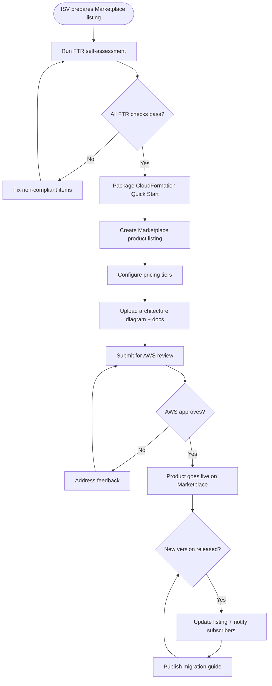

# US-13.1.2: AWS Marketplace Listing & FTR Compliance

> **Spec Kit Specification**: [Specification Lifecycle Active (.specify/)](../../../.specify/memory/constitution.md)  
> **Domain Feature**: `administration-and-operations`  
> **Domain Module**: `deployment-and-aws-marketplace`  
> **Autonomous Behaviour**: `aws-marketplace-listing-ftr-compliance`  
> **Client Framework Path**: `apps/storefront/src/features/administration-and-operations/modules/deployment-and-aws-marketplace/behaviours/aws-marketplace-listing-ftr-compliance`  
> **Backend Framework Path**: `backend/src/features/administration-and-operations/modules/deployment-and-aws-marketplace/behaviours/aws-marketplace-listing-ftr-compliance`  
> **Execution Sprint**: [Sprint 5.1](../../sprints/README.md)  
> **Slicing Standard**: [10-PR Vertical Slicing Framework](../../sprints/README.md#the-10-pr-vertical-slicing-standard-aligned-with-10-pillar-system-architecture)  
> **Security Gateway**: [ASVS Level 2 Verification Gate (security-audit)](#5-security-gateway-powered-by-security-audit)

---

## 1. Spec Kit Specification: User Story & Domain Scope

### 1.1 User Story Narrative

**As an** ISV listing some-commerce on the AWS Marketplace,  
**I want** the product to pass the Foundational Technical Review (FTR) and be listed as a SaaS or AMI product,  
**So that** AWS customers can discover, subscribe, and deploy the platform through the Marketplace.

### 1.2 Acceptance Criteria (Gherkin Scenarios)

```gherkin
Feature: AWS Marketplace Listing
  Scenario: [AC-US-13.1.2-01] FTR audit compliance
    Given the product is submitted for FTR
    Then the following requirements are met:
      - No hardcoded AWS credentials in code or config
      - All data encrypted at rest (KMS) and in transit (TLS 1.2+)
      - CloudTrail logging enabled for all API calls
      - IAM policies follow least-privilege principle
      - VPC configuration uses private subnets for compute
      - Customer data isolation (DynamoDB tenant_id partitioning)
      - GDPR data deletion capabilities via Right to Erasure API
      - SOC 2 Type II compatible logging and audit trails
  Scenario: [AC-US-13.1.2-02] Quick Start CloudFormation template
    Given the Marketplace listing includes a Quick Start template
    When a customer clicks "Continue to Subscribe" → "Continue to Configuration"
    Then the CloudFormation stack launch page opens with:
      - Required params: AdminEmail, TenantName
      - Optional params: computeMode, domainName, acmCertArn
      - Default VPC CIDR and subnet allocation
    And the stack deploys within 25 minutes
  Scenario: [AC-US-13.1.2-03] Marketplace product page
    Then the listing page includes:
      - Product description with feature highlights
      - Architecture diagram
      - Pricing tiers (Free Tier, Standard, Enterprise)
      - Support information and documentation links
      - Usage guide and getting started tutorial
  Scenario: [AC-US-13.1.2-04] Software version update
    When a new version is released
    Then the Marketplace listing is updated
    And existing subscribers receive an update notification
    And a migration guide is published
  Scenario: [AC-US-13.1.2-LAW] Global e-commerce legal compliance and cloud marketplace procurement regulations
    Given listing the commerce platform on the AWS Marketplace for commercial customer procurement
    When validating product architecture against AWS Marketplace requirements
    Then the solution architecture must satisfy all AWS Foundational Technical Review (FTR) security and operational criteria
    And marketplace subscription agreements must incorporate transparent customer terms, SLAs, and liability limitations
    And disaster recovery RPO/RTO metrics must be verified through automated failover drills meeting marketplace listing requirements
```

### 1.3 Test Cases & Traceability Matrix

| # | Test Case | Type | Expected Result |
|:--|:----------|:-----|:----------------|
| TC-13.1.2-01 | FTR: no hardcoded credentials | Security | Pass |
| TC-13.1.2-02 | FTR: data encrypted at rest | Security | KMS on all storage |
| TC-13.1.2-03 | FTR: TLS 1.2+ in transit | Security | All endpoints HTTPS |
| TC-13.1.2-04 | FTR: CloudTrail enabled | Audit | All API calls logged |
| TC-13.1.2-05 | FTR: least-privilege IAM | Security | No * permissions |
| TC-13.1.2-06 | FTR: private subnets | Network | Lambda in private subnet |
| TC-13.1.2-07 | FTR: tenant isolation | Security | DynamoDB partitioned |
| TC-13.1.2-08 | FTR: GDPR deletion | Compliance | Right to Erasure works |
| TC-13.1.2-09 | Quick Start deployment | Happy Path | Deploys in <25 min |
| TC-13.1.2-10 | Subscriber notification on update | Happy Path | Notification sent |
| TC-13.1.2-11 | Product page completeness | Validation | All sections present |
| TC-13.1.2-12 | Version rollback capability | DevOps | Previous version restorable |
| TC-13.1.2-LAW | Global legal & regulatory compliance (AWS Marketplace Customer Agreement, AWS Foundational Technical Review FTR security baselines) | Legal / Regulatory | Statutory compliance verified with zero legal or regulatory violations |

---

## 2. Behavior-Centric Architecture & Folder Blueprint

This user story is implemented directly inside the respective **Expo client** and **Cargo Lambda Axum backend** frameworks according to the **Locality of Behavior (LoB)** architectural law. Private services, designs, logic, types, and constants are strictly colocated within their framework behaviour directory.

### 2.1 Colocated Behaviour Directory Tree

#### Client Architecture (Universal Expo SDK 58):
```
apps/storefront/src/features/administration-and-operations/modules/deployment-and-aws-marketplace/behaviours/aws-marketplace-listing-ftr-compliance/
├── services/
│   │   ├── ftr_compliance_auditor.rs
│   │   ├── aws_config_rule_checker.rs
│   │   ├── ftr_api.ts
├── designs/
│   │   ├── FtrAuditScorecardScreen.tsx
│   │   ├── ComplianceChecklistWidget.tsx
│   │   ├── ExportReportButton.tsx
├── logic/
│   │   ├── useFtrCompliance.ts
│   │   ├── well_architected_evaluator.rs
│   │   ├── disaster_recovery_tester.rs
├── types/
│   │   ├── FtrRequirementItem.ts
│   │   ├── ComplianceEvidenceRecord.ts
│   │   ├── FtrRemediationPlan.ts
└── constants/
│   │   ├── FtrEndpoints.ts
│   │   ├── FtrCategories.ts
│   │   ├── FtrErrorCodes.ts
```

#### Backend Architecture (Cargo Lambda + Axum 0.8):
```
backend/src/features/administration-and-operations/modules/deployment-and-aws-marketplace/behaviours/aws-marketplace-listing-ftr-compliance/
├── services/
│   │   ├── ftr_compliance_auditor.rs
│   │   ├── aws_config_rule_checker.rs
│   │   ├── ftr_api.ts
├── logic/
│   │   ├── useFtrCompliance.ts
│   │   ├── well_architected_evaluator.rs
│   │   ├── disaster_recovery_tester.rs
├── types/
│   │   ├── FtrRequirementItem.ts
│   │   ├── ComplianceEvidenceRecord.ts
│   │   ├── FtrRemediationPlan.ts
└── constants/
│   │   ├── FtrEndpoints.ts
│   │   ├── FtrCategories.ts
│   │   ├── FtrErrorCodes.ts
```

### 2.2 Scoping & Promotion Blueprint

| Layer / Tier | Client Path (Expo) | Backend Path (Cargo Lambda / Axum) | Purpose & Promotion Rules |
| :--- | :--- | :--- | :--- |
| **Behaviour-Local** | `.../behaviours/aws-marketplace-listing-ftr-compliance/` | `.../behaviours/aws-marketplace-listing-ftr-compliance/` | **Default Private Scope**: Colocated services, designs, logic, types, and constants private to this story. |
| **Module-Shared** | `.../modules/deployment-and-aws-marketplace/_shared/` | `.../modules/deployment-and-aws-marketplace/_shared/` | Shared domain primitives and UI elements used by $\ge 2$ behaviours in `deployment-and-aws-marketplace`. |
| **Feature-Shared** | `.../features/administration-and-operations/_shared/` | `.../features/administration-and-operations/_shared/` | Feature-level contracts, ports, and cross-module bridges across `administration-and-operations`. |
| **Framework-Shared** | `apps/storefront/src/shared/` | `backend/crates/kernel-core/` | System-wide microkernel traits, `Money` arithmetic, RFC 9110 ETag middleware, and database adapters. |

---

## 3. Technical Implementation Plan (Spec Kit Plan)

### 3.1 Domain Invariants & Storage Schema
- **State Machine**: Enforces valid state transitions and rejects unauthorized or out-of-order mutations.
- **Data Persistence**: Single-table Amazon DynamoDB partitioning (`PK = TENANT#<id>`, `SK = ENTITY#<id>`) paired with reactive local-first WatermelonDB sync.
- **Freshness & Caching**: Multi-tier caching (L1 Moka in-memory + L2 ElastiCache Redis) with RFC 9110 `ETag` conditional `304 Not Modified` short-circuiting.

### 3.2 Activity & Interaction Diagram



---

## 4. Granular Implementation Tasks (Spec Kit Tasks)

### Phase 1: Core Domain Logic, Types & Constants
- [ ] **Task 1.1 (Types)**: Define strongly typed models and DTO schemas in `types/`.
- [ ] **Task 1.2 (Constants)**: Define routes, action codes, and validation limits in `constants/`.
- [ ] **Task 1.3 (Logic)**: Implement pure business logic, calculations, and state machines in `logic/`.
- [ ] **Task 1.4 (Unit Tests)**: Write pure property-based and unit tests verifying domain invariants.

### Phase 2: Services & Infrastructure Adapters
- [ ] **Task 2.1 (API / Gateway)**: Implement client adapters and backend handlers in `services/`.
- [ ] **Task 2.2 (ETag & Cache)**: Integrate RFC 9110 ETag headers and multi-tier caching (Moka L1 / Redis L2).
- [ ] **Task 2.3 (Storage & Sync)**: Implement DynamoDB storage operations and WatermelonDB delta sync.
- [ ] **Task 2.4 (Integration Tests)**: Verify service contract tests and real database conditional writes.

### Phase 3: Platform-Adaptive Designs & UI
- [ ] **Task 3.1 (UI Presentation)**: Build platform-adaptive screens and SDUI components in `designs/`.
- [ ] **Task 3.2 (Headless Hooks)**: Bind headless domain hooks from `logic/` into the UI presentation.
- [ ] **Task 3.3 (i18n & RTL)**: Implement bidirectional RTL/LTR layout mirroring and localized font switching.
- [ ] **Task 3.4 (Component Tests)**: Test empty, loading, offline, and error states across web and mobile.

### Phase 4: Security Gateway Verification & Release Readiness
- [ ] **Task 4.1 (Abuse Testing)**: Execute automated adversarial penetration tests against the threat matrix.
- [ ] **Task 4.2 (Zero-Trust Audit)**: Verify strict tenant isolation and object-level authorization (IDOR).
- [ ] **Task 4.3 (SAST & Audit)**: Run static analysis, dependency audit, and secret scanning.
- [ ] **Task 4.4 (Gate Sign-Off)**: Obtain independent security sign-off for the G2 Security Gateway.

---

## 5. Security Gateway (Powered by security-audit)

### 5.1 Trust Boundaries & Security Actors
- **Trust Boundaries**:
  - `Untrusted Zone`: Mobile client app, public web browser, and external network callers.
  - `Gateway Edge`: AWS CloudFront, API Gateway, and Cognito JWT authentication guard.
  - `Secure Application Boundary`: Axum Tower route extractors enforcing tenant and RBAC/ABAC isolation.
  - `Encrypted Storage & Secret Vault`: Amazon DynamoDB KMS-encrypted tables and AWS KMS vault.
- **Authorized Principals**:
  - Identified Actors: `AuthenticatedCustomer`, `B2bBuyer`, `Vendor`, `StoreAdmin`, or `AnonymousShopper` (read-only).
  - Multi-Tenancy Invariant: Every request must extract `tenant_id` from verified JWT claims. Injections via query params or payload body are rejected with `403 Forbidden`.

### 5.2 Threat Modeling & Abuse Matrix (STRIDE / ASVS)

| Threat Vector | Severity | Vulnerability Mechanism | Mitigating Control & Security Invariant |
| :--- | :--- | :--- | :--- |
| **Spoofing & Impersonation** | Critical | Forged `sub` or `tenant_id` identity claims | Server-side RS256 JWKS signature verification; strict claims extraction in Axum. |
| **Tampering & Invariant Bypass** | High | Manipulating payload parameters or prices | Authoritative server recalculation; strict schema validation; BLAKE3 ETag integrity checks. |
| **Information Disclosure (IDOR)** | Critical | Cross-tenant or cross-user data scraping | Explicit `PK = TENANT#<id>` partition filtering on every database and cache operation. |
| **Denial of Service / Abuse** | High | Falsifying compliance evidence reports, hidden non-compliant security group ingress rules | Token-bucket rate limiting per IP and account; strict input length validation. |
| **Elevation of Privilege** | Critical | Bypassing role-based permission checks | Tower extractors (`RequireStoreAdmin`, `RequireVendor`) guard sensitive endpoints. |

### 5.3 Cryptographic & Data Protection Controls
- **Encryption in Transit**: TLS 1.3 enforced on all external and internal endpoints; HSTS active.
- **Encryption at Rest**: DynamoDB AWS KMS customer-managed keys; AES-256-GCM for sensitive client tokens in `expo-secure-store`.
- **PII & Secret Redaction**: Passwords, OTPs, auth tokens, and credit card numbers are stripped from logs and traces via `tracing` redaction filters.

### 5.4 Automated Security Verification Checklist
- [ ] **SAST Analysis**: Clean report from static code analyzers; 0 high or critical vulnerabilities.
- [ ] **Dependency Audit**: `cargo deny` and `bun audit` pass with 0 unreviewed security advisories.
- [ ] **Abuse & IDOR Fuzzing**: Test suite confirms that requests with modified `tenant_id` or `user_id` fail with `401 Unauthorized` or `403 Forbidden`.
- [ ] **Secret Scanning**: Gitleaks scanner confirms zero hardcoded credentials, API keys, or private keys.

### 5.5 Security Gateway (G2) Sign-Off Checklist
- [ ] Threat boundary and entry points verified against OWASP ASVS Level 2 requirements.
- [ ] Multi-tenant isolation verified with automated cross-tenant penetration test.
- [ ] Anti-abuse and rate limiting confirmed active on all public interfaces.
- [ ] Audit log redaction verified — zero plaintext secrets in output logs.
- [ ] Independent reviewer sign-off obtained; zero open Critical or High findings.

---

## 6. Validation Gates & Acceptance Sign-Off

**Status: Pending — specification only; no implementation evidence.** All [G0–G4 quality gates + G-Review + G-Borrow + G-UI + G-Law](../../QUALITY_GATES.md) apply to this story. The following checks add to its acceptance criteria and test cases; they do not replace them.

### G1 — Test coverage
- [ ] **US-13.1.2-G1:** Automated test suite maps 100% of acceptance criteria and test cases with >=90% line and >=85% branch coverage in affected packages.

### G2 — Security audit
- [ ] **US-13.1.2-G2:** Verify zero-trust tenant isolation, object-level authorization (IDOR), and defense against Falsifying compliance evidence reports, hidden non-compliant security group ingress rules. No unresolved critical or high findings.

### G3 — Architecture and maintainability
- [ ] **US-13.1.2-G3:** Strict compliance with framework colocation (`apps/storefront/src/features/` or `backend/src/features/`), zero-clone borrowing discipline in Rust, and clean domain boundaries.

### G-Review — Code review
- [ ] **US-13.1.2-G-Review:** Independent senior code review signed off by the Code Reviewer; verification across Correctness, Security, Maintainability, Performance, and Testing using the Agency-Agents code review standard; zero open Blocker or unresolved Suggestion findings.

### G-Borrow — Rust zero-clone borrowing validation
- [ ] **US-13.1.2-G-Borrow:** Backend code relies strictly on borrowing (&T, &mut T), explicit lifetimes, zero-copy byte buffers (bytes::Bytes), and zero unauthorized deep .clone() calls on domain entities and models (Arc::clone and Rc::clone pointer copies permitted only); certified by systems reviewer.

### G-UI — UI/UX validation
- [ ] **US-13.1.2-G-UI:** Pure separation of presentation (designs/, owned by ui-ux-designer) and headless hooks (logic/, owned by client-engineer); mobile components use @expo/ui primitives and native modules; web components use semantic HTML5 styled with Tailwind CSS; WCAG 2.1 AA and Arabic RTL layout parity verified; certified by UI/UX designer.

### G-Law — Law validation
- [ ] **US-13.1.2-G-Law:** Independent verification against global e-commerce legal and statutory requirements: AWS Marketplace Customer Agreement compliance, AWS Foundational Technical Review (FTR) certification, and verified disaster recovery operational SLAs; certified by compliance reviewer (`agency-legal-compliance-checker`).

### G4 — Integrated acceptance
- [ ] **US-13.1.2-G4:** End-to-end user journey validation across supported platforms (Web, iOS, Android) and verified sandbox integration.

---

[← Back to Module deployment-and-aws-marketplace Catalog (README.md)](README.md) | [Master User Stories Index](../README.md)
