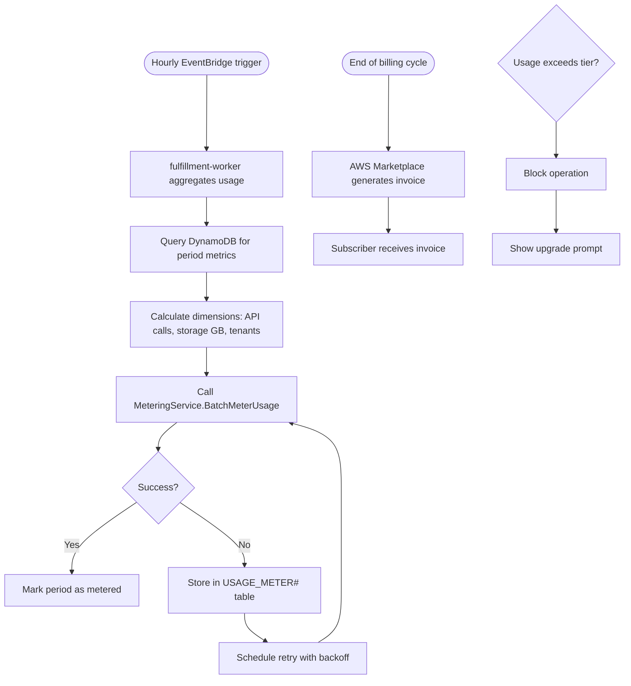

# US-13.1.3: SaaS Metering & Usage-Based Billing

> **Spec Kit Specification**: [Specification Lifecycle Active (.specify/)](../../../.specify/memory/constitution.md)  
> **Domain Feature**: `administration-and-operations`  
> **Domain Module**: `deployment-and-aws-marketplace`  
> **Autonomous Behaviour**: `saas-metering-usage-based-billing`  
> **Client Framework Path**: `apps/storefront/src/features/administration-and-operations/modules/deployment-and-aws-marketplace/behaviours/saas-metering-usage-based-billing`  
> **Backend Framework Path**: `backend/src/features/administration-and-operations/modules/deployment-and-aws-marketplace/behaviours/saas-metering-usage-based-billing`  
> **Execution Sprint**: [Sprint 5.1](../../sprints/README.md)  
> **Slicing Standard**: [10-PR Vertical Slicing Framework](../../sprints/README.md#the-10-pr-vertical-slicing-standard-aligned-with-10-pillar-system-architecture)  
> **Security Gateway**: [ASVS Level 2 Verification Gate (security-audit)](#5-security-gateway-powered-by-security-audit)

---

## 1. Spec Kit Specification: User Story & Domain Scope

### 1.1 User Story Narrative

**As a** SaaS-mode Marketplace subscriber,  
**I want** my usage (API calls, storage GB, active tenants) to be automatically metered and billed,  
**So that** I pay only for what I use.

### 1.2 Acceptance Criteria (Gherkin Scenarios)

```gherkin
Feature: SaaS Metering & Billing
  Scenario: [AC-US-13.1.3-01] Hourly usage metering
    Given the platform runs for a subscriber
    Then every hour, the fulfillment-worker aggregates:
      - Total API requests
      - DynamoDB consumed WCU/RCU
      - S3 storage GB
      - Active tenant count
    And calls MeteringService.BatchMeterUsage with the dimensions
  Scenario: [AC-US-13.1.3-02] Monthly invoice generation
    Given the end of the billing cycle
    Then AWS Marketplace generates an invoice based on metered dimensions
    And the subscriber receives the invoice via AWS
  Scenario: [AC-US-13.1.3-03] Free tier enforcement
    Given the subscriber is on the Free Tier (1,000 products, 1 tenant)
    When the subscriber exceeds 1,000 products
    Then product creation is blocked with "Free tier limit reached"
    And an upgrade prompt is shown
  Scenario: [AC-US-13.1.3-04] Metering failure recovery
    Given a BatchMeterUsage call fails
    Then the usage records are persisted in DynamoDB USAGE_METER# table
    And retried with exponential backoff
    And no usage data is lost
  Scenario: [AC-US-13.1.3-LAW] Global e-commerce legal compliance and SaaS metered billing regulations
    Given metering customer platform consumption (API calls, GMV volume, active vendors) and generating monthly billing events
    When transmitting usage records to AWS Marketplace Metering Service or Stripe Billing
    Then metered usage records must be calculated with idempotent deduplication preventing double billing or under-metering
    And billing statements must provide transparent itemized unit breakdowns with statutory applicable sales tax and VAT
    And raw metering telemetry must be preserved in immutable, tamper-resistant audit logs for financial and tax audit reconciliation
```

### 1.3 Test Cases & Traceability Matrix

| # | Test Case | Type | Expected Result |
|:--|:----------|:-----|:----------------|
| TC-13.1.3-01 | Hourly metering call | Happy Path | Usage reported |
| TC-13.1.3-02 | Monthly invoice | Happy Path | Invoice generated |
| TC-13.1.3-03 | Free tier product limit | Validation | Creation blocked |
| TC-13.1.3-04 | Free tier tenant limit | Validation | Tenant creation blocked |
| TC-13.1.3-05 | Metering failure retry | Error | Data persisted, retried |
| TC-13.1.3-06 | Upgrade from free to standard | Happy Path | Limits updated |
| TC-13.1.3-07 | Metering data accuracy | Validation | Matches actual usage |
| TC-13.1.3-08 | Concurrent metering calls | Concurrency | No double counting |
| TC-13.1.3-LAW | Global legal & regulatory compliance (FTC Truth in Billing guidelines, SaaS jurisdictional sales tax/VAT, SOX financial auditability) | Legal / Regulatory | Statutory compliance verified with zero legal or regulatory violations |

---

## 2. Behavior-Centric Architecture & Folder Blueprint

This user story is implemented directly inside the respective **Expo client** and **Cargo Lambda Axum backend** frameworks according to the **Locality of Behavior (LoB)** architectural law. Private services, designs, logic, types, and constants are strictly colocated within their framework behaviour directory.

### 2.1 Colocated Behaviour Directory Tree

#### Client Architecture (Universal Expo SDK 58):
```
apps/storefront/src/features/administration-and-operations/modules/deployment-and-aws-marketplace/behaviours/saas-metering-usage-based-billing/
├── services/
│   │   ├── marketplace_metering_client.rs
│   │   ├── usage_event_aggregator.rs
│   │   ├── metering_api.ts
├── designs/
│   │   ├── UsageBillingDashboard.tsx
│   │   ├── DimensionMeterGauge.tsx
│   │   ├── InvoiceDisputeSheet.tsx
├── logic/
│   │   ├── useSaasMetering.ts
│   │   ├── metering_signature_builder.rs
│   │   ├── batch_meter_reconciler.rs
├── types/
│   │   ├── UsageMeteringDimension.ts
│   │   ├── BatchMeterUsagePayload.ts
│   │   ├── MeterUsageResult.ts
└── constants/
│   │   ├── MeteringEndpoints.ts
│   │   ├── MarketplaceDimensions.ts
│   │   ├── MeteringErrorCodes.ts
```

#### Backend Architecture (Cargo Lambda + Axum 0.8):
```
backend/src/features/administration-and-operations/modules/deployment-and-aws-marketplace/behaviours/saas-metering-usage-based-billing/
├── services/
│   │   ├── marketplace_metering_client.rs
│   │   ├── usage_event_aggregator.rs
│   │   ├── metering_api.ts
├── logic/
│   │   ├── useSaasMetering.ts
│   │   ├── metering_signature_builder.rs
│   │   ├── batch_meter_reconciler.rs
├── types/
│   │   ├── UsageMeteringDimension.ts
│   │   ├── BatchMeterUsagePayload.ts
│   │   ├── MeterUsageResult.ts
└── constants/
│   │   ├── MeteringEndpoints.ts
│   │   ├── MarketplaceDimensions.ts
│   │   ├── MeteringErrorCodes.ts
```

### 2.2 Scoping & Promotion Blueprint

| Layer / Tier | Client Path (Expo) | Backend Path (Cargo Lambda / Axum) | Purpose & Promotion Rules |
| :--- | :--- | :--- | :--- |
| **Behaviour-Local** | `.../behaviours/saas-metering-usage-based-billing/` | `.../behaviours/saas-metering-usage-based-billing/` | **Default Private Scope**: Colocated services, designs, logic, types, and constants private to this story. |
| **Module-Shared** | `.../modules/deployment-and-aws-marketplace/_shared/` | `.../modules/deployment-and-aws-marketplace/_shared/` | Shared domain primitives and UI elements used by $\ge 2$ behaviours in `deployment-and-aws-marketplace`. |
| **Feature-Shared** | `.../features/administration-and-operations/_shared/` | `.../features/administration-and-operations/_shared/` | Feature-level contracts, ports, and cross-module bridges across `administration-and-operations`. |
| **Framework-Shared** | `apps/storefront/src/shared/` | `backend/crates/kernel-core/` | System-wide microkernel traits, `Money` arithmetic, RFC 9110 ETag middleware, and database adapters. |

---

## 3. Technical Implementation Plan (Spec Kit Plan)

### 3.1 Domain Invariants & Storage Schema
- **State Machine**: Enforces valid state transitions and rejects unauthorized or out-of-order mutations.
- **Data Persistence**: Single-table Amazon DynamoDB partitioning (`PK = TENANT#<id>`, `SK = ENTITY#<id>`) paired with reactive local-first WatermelonDB sync.
- **Freshness & Caching**: Multi-tier caching (L1 Moka in-memory + L2 ElastiCache Redis) with RFC 9110 `ETag` conditional `304 Not Modified` short-circuiting.

### 3.2 Activity & Interaction Diagram



---

## 4. Granular Implementation Tasks (Spec Kit Tasks)

### Phase 1: Core Domain Logic, Types & Constants
- [ ] **Task 1.1 (Types)**: Define strongly typed models and DTO schemas in `types/`.
- [ ] **Task 1.2 (Constants)**: Define routes, action codes, and validation limits in `constants/`.
- [ ] **Task 1.3 (Logic)**: Implement pure business logic, calculations, and state machines in `logic/`.
- [ ] **Task 1.4 (Unit Tests)**: Write pure property-based and unit tests verifying domain invariants.

### Phase 2: Services & Infrastructure Adapters
- [ ] **Task 2.1 (API / Gateway)**: Implement client adapters and backend handlers in `services/`.
- [ ] **Task 2.2 (ETag & Cache)**: Integrate RFC 9110 ETag headers and multi-tier caching (Moka L1 / Redis L2).
- [ ] **Task 2.3 (Storage & Sync)**: Implement DynamoDB storage operations and WatermelonDB delta sync.
- [ ] **Task 2.4 (Integration Tests)**: Verify service contract tests and real database conditional writes.

### Phase 3: Platform-Adaptive Designs & UI
- [ ] **Task 3.1 (UI Presentation)**: Build platform-adaptive screens and SDUI components in `designs/`.
- [ ] **Task 3.2 (Headless Hooks)**: Bind headless domain hooks from `logic/` into the UI presentation.
- [ ] **Task 3.3 (i18n & RTL)**: Implement bidirectional RTL/LTR layout mirroring and localized font switching.
- [ ] **Task 3.4 (Component Tests)**: Test empty, loading, offline, and error states across web and mobile.

### Phase 4: Security Gateway Verification & Release Readiness
- [ ] **Task 4.1 (Abuse Testing)**: Execute automated adversarial penetration tests against the threat matrix.
- [ ] **Task 4.2 (Zero-Trust Audit)**: Verify strict tenant isolation and object-level authorization (IDOR).
- [ ] **Task 4.3 (SAST & Audit)**: Run static analysis, dependency audit, and secret scanning.
- [ ] **Task 4.4 (Gate Sign-Off)**: Obtain independent security sign-off for the G2 Security Gateway.

---

## 5. Security Gateway (Powered by security-audit)

### 5.1 Trust Boundaries & Security Actors
- **Trust Boundaries**:
  - `Untrusted Zone`: Mobile client app, public web browser, and external network callers.
  - `Gateway Edge`: AWS CloudFront, API Gateway, and Cognito JWT authentication guard.
  - `Secure Application Boundary`: Axum Tower route extractors enforcing tenant and RBAC/ABAC isolation.
  - `Encrypted Storage & Secret Vault`: Amazon DynamoDB KMS-encrypted tables and AWS KMS vault.
- **Authorized Principals**:
  - Identified Actors: `AuthenticatedCustomer`, `B2bBuyer`, `Vendor`, `StoreAdmin`, or `AnonymousShopper` (read-only).
  - Multi-Tenancy Invariant: Every request must extract `tenant_id` from verified JWT claims. Injections via query params or payload body are rejected with `403 Forbidden`.

### 5.2 Threat Modeling & Abuse Matrix (STRIDE / ASVS)

| Threat Vector | Severity | Vulnerability Mechanism | Mitigating Control & Security Invariant |
| :--- | :--- | :--- | :--- |
| **Spoofing & Impersonation** | Critical | Forged `sub` or `tenant_id` identity claims | Server-side RS256 JWKS signature verification; strict claims extraction in Axum. |
| **Tampering & Invariant Bypass** | High | Manipulating payload parameters or prices | Authoritative server recalculation; strict schema validation; BLAKE3 ETag integrity checks. |
| **Information Disclosure (IDOR)** | Critical | Cross-tenant or cross-user data scraping | Explicit `PK = TENANT#<id>` partition filtering on every database and cache operation. |
| **Denial of Service / Abuse** | High | Under-reporting customer API usage to avoid licensing fees, duplicate event submission for overbilling | Token-bucket rate limiting per IP and account; strict input length validation. |
| **Elevation of Privilege** | Critical | Bypassing role-based permission checks | Tower extractors (`RequireStoreAdmin`, `RequireVendor`) guard sensitive endpoints. |

### 5.3 Cryptographic & Data Protection Controls
- **Encryption in Transit**: TLS 1.3 enforced on all external and internal endpoints; HSTS active.
- **Encryption at Rest**: DynamoDB AWS KMS customer-managed keys; AES-256-GCM for sensitive client tokens in `expo-secure-store`.
- **PII & Secret Redaction**: Passwords, OTPs, auth tokens, and credit card numbers are stripped from logs and traces via `tracing` redaction filters.

### 5.4 Automated Security Verification Checklist
- [ ] **SAST Analysis**: Clean report from static code analyzers; 0 high or critical vulnerabilities.
- [ ] **Dependency Audit**: `cargo deny` and `bun audit` pass with 0 unreviewed security advisories.
- [ ] **Abuse & IDOR Fuzzing**: Test suite confirms that requests with modified `tenant_id` or `user_id` fail with `401 Unauthorized` or `403 Forbidden`.
- [ ] **Secret Scanning**: Gitleaks scanner confirms zero hardcoded credentials, API keys, or private keys.

### 5.5 Security Gateway (G2) Sign-Off Checklist
- [ ] Threat boundary and entry points verified against OWASP ASVS Level 2 requirements.
- [ ] Multi-tenant isolation verified with automated cross-tenant penetration test.
- [ ] Anti-abuse and rate limiting confirmed active on all public interfaces.
- [ ] Audit log redaction verified — zero plaintext secrets in output logs.
- [ ] Independent reviewer sign-off obtained; zero open Critical or High findings.

---

## 6. Validation Gates & Acceptance Sign-Off

**Status: Pending — specification only; no implementation evidence.** All [G0–G4 quality gates + G-Review + G-Borrow + G-UI + G-Law](../../QUALITY_GATES.md) apply to this story. The following checks add to its acceptance criteria and test cases; they do not replace them.

### G1 — Test coverage
- [ ] **US-13.1.3-G1:** Automated test suite maps 100% of acceptance criteria and test cases with >=90% line and >=85% branch coverage in affected packages.

### G2 — Security audit
- [ ] **US-13.1.3-G2:** Verify zero-trust tenant isolation, object-level authorization (IDOR), and defense against Under-reporting customer API usage to avoid licensing fees, duplicate event submission for overbilling. No unresolved critical or high findings.

### G3 — Architecture and maintainability
- [ ] **US-13.1.3-G3:** Strict compliance with framework colocation (`apps/storefront/src/features/` or `backend/src/features/`), zero-clone borrowing discipline in Rust, and clean domain boundaries.

### G-Review — Code review
- [ ] **US-13.1.3-G-Review:** Independent senior code review signed off by the Code Reviewer; verification across Correctness, Security, Maintainability, Performance, and Testing using the Agency-Agents code review standard; zero open Blocker or unresolved Suggestion findings.

### G-Borrow — Rust zero-clone borrowing validation
- [ ] **US-13.1.3-G-Borrow:** Backend code relies strictly on borrowing (&T, &mut T), explicit lifetimes, zero-copy byte buffers (bytes::Bytes), and zero unauthorized deep .clone() calls on domain entities and models (Arc::clone and Rc::clone pointer copies permitted only); certified by systems reviewer.

### G-UI — UI/UX validation
- [ ] **US-13.1.3-G-UI:** Pure separation of presentation (designs/, owned by ui-ux-designer) and headless hooks (logic/, owned by client-engineer); mobile components use @expo/ui primitives and native modules; web components use semantic HTML5 styled with Tailwind CSS; WCAG 2.1 AA and Arabic RTL layout parity verified; certified by UI/UX designer.

### G-Law — Law validation
- [ ] **US-13.1.3-G-Law:** Independent verification against global e-commerce legal and statutory requirements: FTC Truth in Billing regulations, SaaS tax and VAT calculation accuracy, and SOX-compliant immutable financial audit logs; certified by compliance reviewer (`agency-legal-compliance-checker`).

### G4 — Integrated acceptance
- [ ] **US-13.1.3-G4:** End-to-end user journey validation across supported platforms (Web, iOS, Android) and verified sandbox integration.

---

[← Back to Module deployment-and-aws-marketplace Catalog (README.md)](README.md) | [Master User Stories Index](../README.md)
