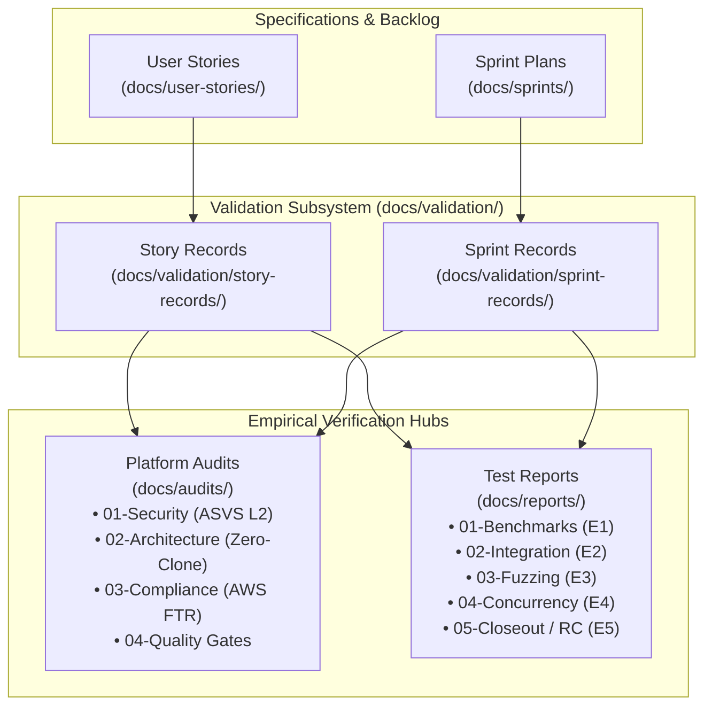

# some-commerce: Validation & Quality Gate Evidence Hub

> **Governing Quality Standards**: [QUALITY_GATES.md](../QUALITY_GATES.md) · [SPRINT_TESTING.md](../SPRINT_TESTING.md) · [AGENT_PROFILES_AND_MULTI_AGENT_FRAMEWORK.md](../AGENT_PROFILES_AND_MULTI_AGENT_FRAMEWORK.md)

This directory serves as the authoritative operational validation center for `some-commerce`. It houses canonical records, evidence templates, and validation sign-offs produced independently of code implementation branches.

---

## 1. Directory Structure & Subsystems

```
docs/validation/
├── README.md                              # ◄◄ THIS FILE (Validation Hub Index)
├── STORY_RECORD_TEMPLATE.md               # Standard template for canonical story operational records
├── STORY_EVIDENCE_TEMPLATE.md             # Standard template for story-level G0–G4 gate evidence
├── SPRINT_TEST_EVIDENCE_TEMPLATE.md       # Standard template for sprint-level E1–E5 test evidence
├── story-records/                         # Canonical operational history per user story (US-<id>.md)
│   └── README.md
└── sprint-records/                        # Canonical operational history per sprint (SPRINT-<id>.md)
    └── README.md
```

---

## 2. Cross-Directory Architecture

The validation subsystem connects specifications, implementation evidence, formal audits, and operational reports:



---

## 3. Accountable Multi-Agent Roles

Per company role specifications in [`docs/COMPANY_ROLES_AND_AGENT_PROFILES.md`](../COMPANY_ROLES_AND_AGENT_PROFILES.md):
- **`qa-security-auditor` / `senior-security-qa-auditor`**: Writes exclusively to `docs/validation/**` and test execution runners. Authors independent security, fuzzing, and compliance evidence.
- **`system-architect`**: Reviews Gate M1 microkernel purity, Rust zero-clone compliance, and folder architecture.
- **`release-gatekeeper`**: Audits that all required story records (`US-<id>.md`), sprint records (`SPRINT-<id>.md`), and E1–E5 report digests are fully populated and unbroken before allowing candidate promotion.
- **`chief-technology-officer`**: Executive L6 review of closeout evidence packages before issuing release recommendations.
